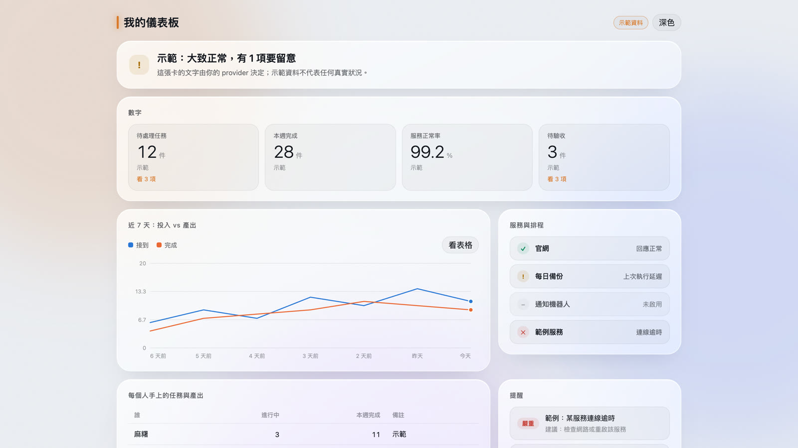
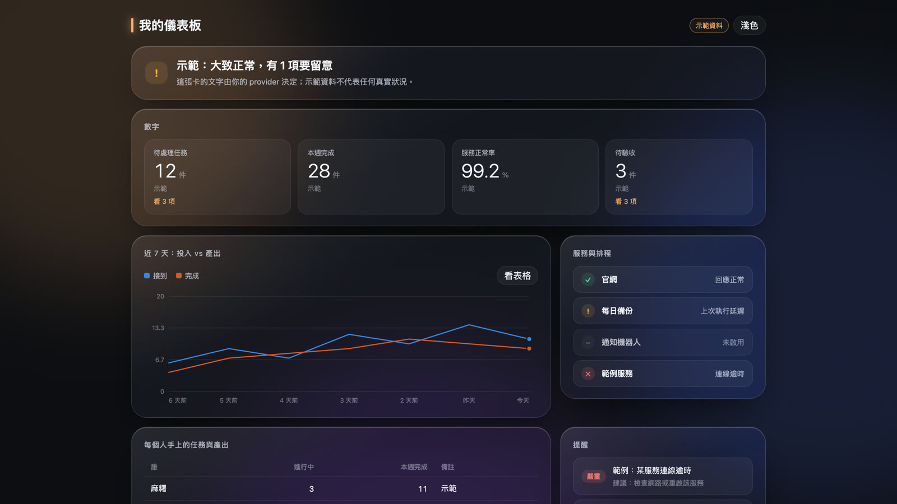

# teahouse-dashboard　玻璃質感儀表板

<p>
  <a href="https://github.com/josenjc9/teahouse-dashboard/stargazers"></a>
  <a href="LICENSE"></a>
</p>

用一份 JSON 描述你想看的東西，寫幾支小腳本接上自己的資料；某個資料源壞了只會變成一張紅色提醒，不會整頁壞掉。全部在你自己的電腦上跑，不需要帳號或金鑰。

如果這個專案有幫到你，點右上角的 **⭐ Star**，讓更多人找得到。

| 淺色 | 深色 |
|---|---|
|  |  |

*畫面是內附的示範資料，不代表任何真實狀況。*

*A glassy, local-first dashboard driven by one JSON contract. Write small provider scripts for your own data; a broken provider becomes a red alert card instead of a broken page.*

## 當成 Skill 使用

```bash
git clone https://github.com/josenjc9/teahouse-dashboard.git ~/.claude/skills/teahouse-dashboard
```

放好後對 agent 說「幫我做一個儀表板」，它會照 `SKILL.md` 帶你做完。不用 git 的話，用 **Code → Download ZIP**，解壓縮後把資料夾放進 skills 目錄。

## 一分鐘看效果

```bash
python3 scripts/build_dashboard.py     # 執行 providers/ 合併成 app/public/data/dashboard.json
cd app && npm install && npm run dev   # 開 http://127.0.0.1:5180/
```

需要 Node.js 20.19+（或 22.12+）、Python 3.9+、瀏覽器。

## 七種卡片

| 類型 | 用途 |
|---|---|
| `verdict` | 整體判讀（自動產生：有異常／要留意／一切正常） |
| `stat` | 數字，可點開看明細 |
| `trend` | 折線或長條，最多 3 條 |
| `table` | 表格 |
| `status` | 服務狀態清單（正常／注意／異常／未連線） |
| `quota` | 額度進度條：已用／上限／重置時間，依用量變色（資料由你自己填，不連任何服務帳號） |
| `alerts` | 要人處理的提醒 |

## 接你自己的資料

每件想看的事寫一支 `providers/<名稱>.py`，stdout 印出符合 `schemas/dashboard.schema.json` 的 JSON。規則與可直接貼給 agent 的提示詞見 [接入說明-儀表板.md](接入說明-儀表板.md)。

內附四支範例：任務看板統計、本機 git 提交數、網址連線檢查、額度進度條（讀你自己填的 `quota.json`）。

## 安全

只在本機跑：開發伺服器只聽 `127.0.0.1`，不連外部服務、沒有追蹤。詳見 [SECURITY.md](SECURITY.md)。

## 相關專案

想要角色會走動的 3D 庭院版，見 [agent-teahouse](https://github.com/josenjc9/agent-teahouse)，那裡的 Office 也內含同一套儀表板分頁。

如果這個專案對你有用，歡迎給它一顆 ⭐，也歡迎開 issue 告訴我哪裡不好用。
